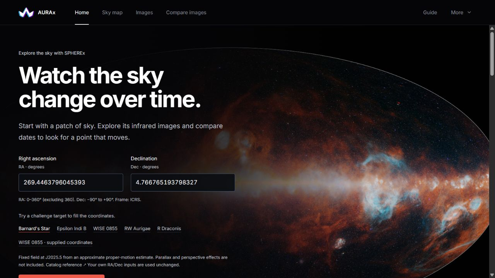
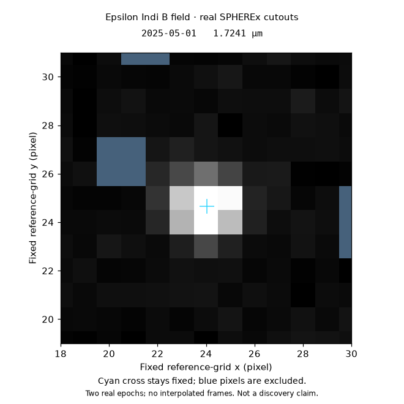

# AURAx

Explore the changing infrared sky with real NASA SPHEREx observations.

[Open the live app](https://aurax.thawshi.com) · [User guide](docs/user-guide.md) · [Documentation](docs/README.md) · [Contribute](CONTRIBUTING.md)



Enter a sky coordinate or choose a target, inspect calibrated infrared cutouts, and compare two to four observations on a shared sky grid. Animated playback, wavelength information, quality masks, and original data references help you investigate an apparent change.

## Try a real time comparison

1. Open [AURAx](https://aurax.thawshi.com).
2. Choose **Try a checked Epsilon Indi B time comparison** on Home.
3. Select **Analyse 2 images** to retrieve the two small cutouts.
4. Once preparation succeeds, inspect the grid or switch to Blink and use Play.
5. Read **Quality** and **Details** before interpreting any shift.

The example spans about 509 days with closely matching local wavelengths. It illustrates a known moving source; it is not precision astrometry or a new discovery. Archive availability still controls whether the data can be retrieved.



*Previously recorded validation animation: two actual observations, with no generated intermediate frames. Blue pixels are excluded. See the [evidence and limits](docs/epsilon-indi-example-validation-2026-11-15.md).*

## What you can do

- Resolve object names with SIMBAD or enter ICRS RA/Dec in degrees.
- Browse SPHEREx observations by date, detector, and other metadata.
- Inspect images and selected regions with calibrated values and data-quality information.
- Compare two to four images, or use stricter wavelength-matched blink checks.
- Start with small, nominal 50-pixel target-centred cutouts; choose larger fields when needed.
- Save targets and load bounded nearest-pixel spectral samples with uncertainties.
- Reuse cached data; report archive failures without fabricating replacement observations.

General comparisons can mix passbands. A display difference alone does not establish motion, variability, or a new object. Read the [scientific interpretation guide](docs/scientific-limits.md).

## Documentation

| I want to… | Start here |
| --- | --- |
| Use the app with screenshots | [User walkthrough](docs/user-guide.md) |
| Run it on my computer | [Development setup](docs/development.md) |
| Understand the system | [Architecture](docs/architecture.md) |
| Call the API | [API reference](docs/api-reference.md) |
| Understand FITS retrieval and caching | [Data pipeline](docs/data-pipeline.md) |
| Deploy or update an existing server | [Deployment](docs/deployment.md) |
| Contribute a change | [Contributing](CONTRIBUTING.md) |
| Learn why we built it | [Behind the project](docs/project-story.md) |
| Check evidence and limits | [Challenge audit](docs/challenge-audit-2026-11-15.md) |
| Read credits and AI assistance disclosure | [Credits](docs/credits.md) · [AI disclosure](docs/ai-disclosure.md) |

## Develop locally

Install Python 3.11+, [uv](https://docs.astral.sh/uv/), and [Bun](https://bun.sh/). Clone the repository, then run:

```sh
./dev
```

On Windows, double-click `dev.cmd`. A checkout in WSL uses the tools installed inside that distribution. The launcher starts both servers, reports their ports, and opens the app. Ctrl+C stops its managed session. Docker is optional. See [setup and troubleshooting](docs/development.md).

## Project links

- [Live application](https://aurax.thawshi.com)
- [Interactive documentation](https://aurax.thawshi.com/docs)
- [Walkthrough video](https://www.youtube.com/watch?v=1ehcAh00yY8)
- [Supporting materials](https://drive.google.com/drive/folders/16kaDiCB-tFyycD5B6L1ZEZ3-a3SuzLoH?usp=drive_link)

## Data and development acknowledgement

Observation products come from NASA/IPAC IRSA; SIMBAD supplies catalog references. See [data and image credits](docs/credits.md). OpenAI Codex and Google Gemini assisted with coding. See [where AI was used and how scientific data remain separate](docs/ai-disclosure.md).

This project is an independent NASA Space Apps Challenge entry. NASA imagery and mission references do not imply endorsement.
