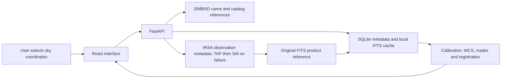

# Architecture

[Documentation](README.md) · [API reference](api-reference.md)

## Request flow

TAP and SIA are official routes into IRSA, not independent mirror archives. A failure can still affect both. Name resolution and catalog references use SIMBAD; astronomical pixels come from SPHEREx archive products.

## Components

| Location | Responsibility |
| --- | --- |
| [frontend/src/views](../frontend/src/views) | Home, images, comparisons, documentation, and saved-target views |
| [frontend/src/components](../frontend/src/components) | FITS rendering, region inspection, controls, and navigation |
| [frontend/src/services](../frontend/src/services) | Browser API clients and response validation |
| [frontend/src/content/docs](../frontend/src/content/docs) | User-facing conceptual guide articles |
| [backend/app](../backend/app) | API routes, archive services, image processing, jobs, and cache handling |
| [backend/tests](../backend/tests) | Backend regression checks |
| [scripts](../scripts) | Development launcher, container checks, and real-data validation utilities |
| [docker](../docker) | Development/production Compose, Nginx, and container configuration |
| [.github/workflows](../.github/workflows) | Automated checks and image publication |

## Image and comparison preparation

Metadata discovery does not immediately download every image. Users select observations and explicitly start preparation. Small calibrated cutouts are retrieved sequentially; the image workflow retains physical values and quality information. Comparisons register images to a common sky grid and display shared usable coverage.

General comparison supports two to four observations across passbands. Checked blink adds stricter wavelength and time requirements. Display stretching affects appearance, not calibrated measurements. Read [scientific limits](scientific-limits.md) before using a visual change as evidence.

## Persistence and jobs

SQLite stores reusable metadata; local files retain FITS products under configured quotas. In-memory jobs provide bounded polling/cancellation workflows, not durable distributed task execution. A restart discards runtime job histories while persistent cached files may remain.

Use one backend process/container per cache volume. Process-local admission and lease coordination do not support a shared cache across workers or replicas. See [data pipeline](data-pipeline.md).

## Deployment boundary

Vite proxies API calls during development. Production Nginx serves the built frontend and forwards backend requests. Immutable matching commit tags identify frontend/backend images. HTTPS and certificate handling are described in [Deployment](deployment.md).
