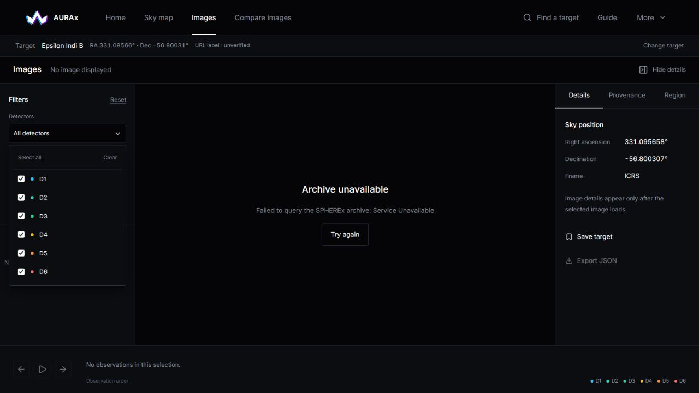
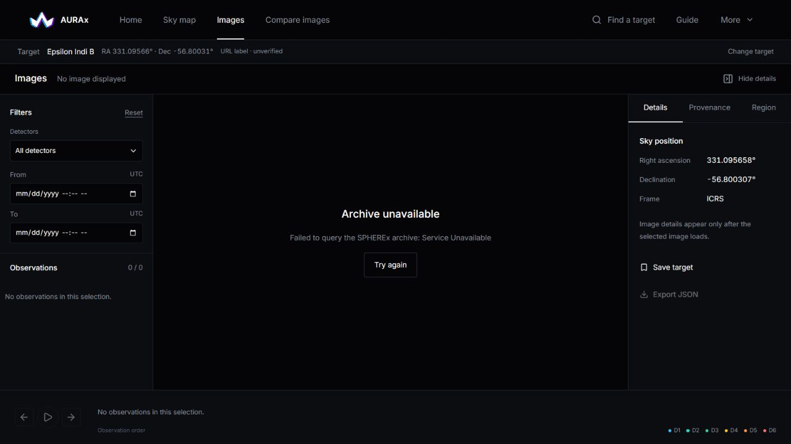

# Images: browse and inspect real observations

[Documentation](README.md) · [Sky map](sky-map-guide.md) · [Comparison walkthrough](user-guide.md)

The **Images** workspace queries SPHEREx observations for the active sky position and displays one selected calibrated cutout at a time. Observation metadata, image download, and image rendering are separate stages.

## 1. Open a position

Choose a challenge target on Home to open its Images workspace. For your own position, enter RA/Dec and select **Open images**. Older deployments may show **Load image sequence** and fill-only example shortcuts until the updated frontend is deployed.

You can also use **Observe** on a Sky map reference region. Check the target and coordinate header: the position determines the query; a name supplied in a URL is not independent verification of source identity.

## 2. Filter the observation list

The left panel contains:

- **Detectors:** choose any subset of D1–D6. Select all and Clear adjust the checkbox selection.
- **From / To UTC:** constrain the available dates and times.
- **Reset:** restore the date and detector filters.
- **Observations:** select a returned record to load its cutout.

These controls filter a bounded retrieved list; they do not promise a complete archive history. Reset an overly restrictive filter before interpreting an empty selection. A detector's range is not the exact wavelength at your target.

*Capture state: the detector menu is open and the retried archive request has returned Service Unavailable. This screenshot demonstrates controls; it does not show successfully retrieved observations.*

## 3. Inspect a loaded cutout

Once a record and its FITS image load:

1. Read the displayed date, detector, and wavelength at target.
2. Keep the default nominal 50-pixel field for a quick first inspection. The field-of-view control offers larger cutouts when context is needed; actual returned dimensions are authoritative.
3. Use pan, zoom, and Fit to inspect the cutout.
4. Choose a display stretch or colormap to reveal structure. These affect the display, not the native calibrated brightness values.
5. Inspect warnings, masks, and unusable areas. A dark valid pixel and an excluded pixel mean different things.

Catalog overlays show SIMBAD reference positions. They do not certify a source detection, motion-corrected association, or resolved binary.

## 4. Use Details, Provenance, and Region

| Tab | What to inspect |
| --- | --- |
| Details | Target coordinates, detector, local wavelength, exposure, returned dimensions, and brightness unit after loading |
| Provenance | Archive information, possible truncation, observation identity, and original image link |
| Region | A selected position's local image detail, aperture/background diagnostics, uncertainties, and quality checks |

Click a region in a loaded image to inspect it. Selecting a nearby catalog name attempts to centre that exact reference position. An out-of-image reference is reported rather than replaced with another source.

Measurements can be blocked by insufficient quality-screened coverage. Formal uncertainty does not include every systematic effect. See [scientific limits](scientific-limits.md).

## 5. Browse the timeline

Select a timeline entry or use **Previous** and **Next**. **Play** requires at least two available observations; it advances after the current image has loaded. Pause before inspecting a particular feature.

Images playback can mix wavelengths and sky grids. It is exploratory browsing, not strict matched-wavelength blink. For aligned two-to-four-image viewing and stricter time checks, use [Compare images](user-guide.md).

## 6. Save and export

**Save target** retains the target in the current browser. **Export JSON** becomes available after an image loads and exports its data/context rather than a discovery claim. Saved targets have a separate explicit action for loading bounded spectral samples.

## 7. Recognize archive failures

*Direct live capture on 15 November 2026: the archive query returned Service Unavailable. No science image was displayed or substituted.*

At capture time, this Images request did not produce a loaded observation. The workflow instructions above were checked against the implementation; a successful fresh observation in this tab is not certified by these screenshots. The separate [checked comparison](user-guide.md) has recorded live successfully rendered images.

| State | Meaning and next step |
| --- | --- |
| Finding observations | Metadata is being requested; it does not mean a FITS image has loaded |
| Archive unavailable | The service request failed; use Try again later |
| No observations available | The returned query had no matching records; review position and constraints |
| No observations match these filters | The retrieved list exists, but current filters exclude it |
| Selected observation unavailable | The retained selection is absent from the current result or filters |
| Image retrieval error | Metadata was found, but its image could not be loaded; follow the visible retry action |

An outage is not evidence that the sky field is empty. Health checks, a successful HTTP response, or cached metadata do not independently establish detection or variability.

Next: [comparison walkthrough](user-guide.md), [scientific limits](scientific-limits.md), or [data pipeline](data-pipeline.md).
