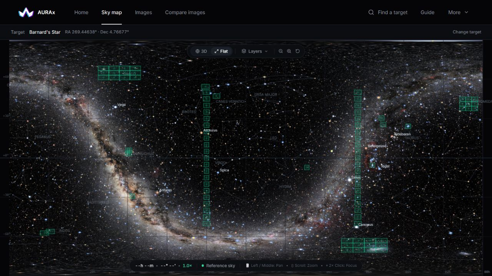
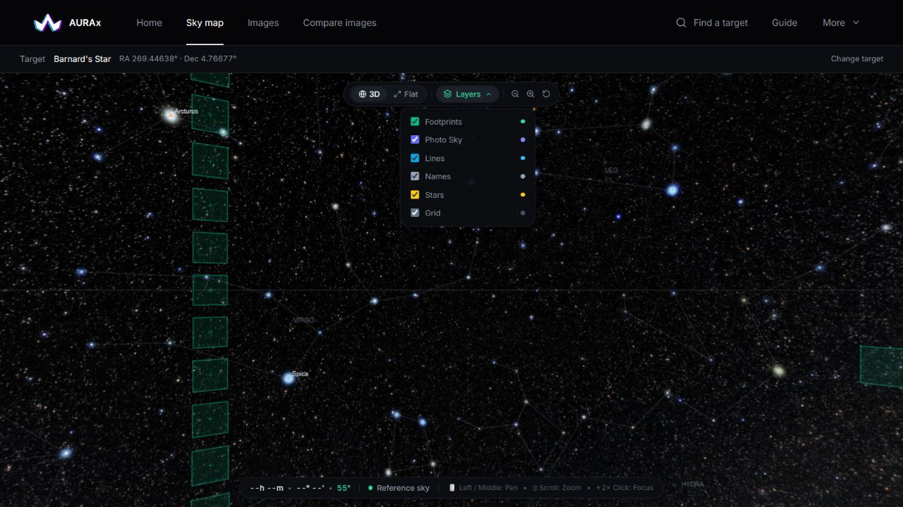

# Sky map: navigate before opening observations

[Documentation](README.md) · [Live Sky map](https://aurax.thawshi.com/sky) · [Images guide](images-guide.md)

Sky map is a reference view for orientation and choosing regions. Its photographic background, stars, constellation overlays, and bundled reference footprints are **not a live SPHEREx exposure or a verified current coverage map**. Use Images to query actual archive observations.

## 1. Choose a projection

Open **Sky map** in the top navigation.

- **3D** shows a globe-style sky view. Drag to pan and scroll to zoom.
- **Flat** switches to a panoramic view.
- **Zoom In**, **Zoom Out**, and **Reset** are in the floating toolbar.
- The bottom bar shows the hovered sky coordinate and the current field of view or zoom. Hover coordinates do not automatically change the active target shown in the page header.

*Direct live capture on 15 November 2026. This is reference imagery for navigation, not a SPHEREx science frame.*

## 2. Adjust Layers

Open **Layers** in the floating toolbar. Toggle individual items to reduce clutter:

| Layer | Purpose and limitation |
| --- | --- |
| Footprints | Bundled reference regions that can be selected; not freshly queried exposure coverage |
| Photo Sky | Photographic navigation background; not the target's calibrated SPHEREx image |
| Lines | Constellation lines for orientation |
| Names | Constellation labels |
| Stars | Reference star markers |
| Grid | Coordinate grid for orientation |

The **Reference sky** label is intentional. A green box is not proof that an observation is available, that a source is detected, or that the displayed area is complete.

## 3. Open a reference region

With Footprints enabled, click an available reference box. The region inspector shows its name and identifier.

- **Focus** centres the map on that reference region.
- Double-clicking a reference footprint also focuses and selects it.
- **Observe** submits the reference region's centre coordinates through the backend and opens Images.
- **Close** dismisses the selected reference region.

Observe starts a real archive workflow; it does not turn the navigation background into observation data. A coordinate request can fail, or the archive can have no usable observations for the chosen centre.

## 4. Use an exact target instead

For a precise coordinate or named object, return to **Home** or use **Find a target**. Confirm the RA/Dec and then open Images. Clicking a reference region uses that region's centre, which may differ from a particular star within it.

## If the view is confusing

- Hide Footprints or Photo Sky to simplify the display.
- Use Reset to restore the map view.
- Confirm which target is shown in the header before opening Images from navigation.
- Check [image provenance and credits](credits.md); navigation photos and archive observations have different sources and purposes.

Next: [Images walkthrough](images-guide.md), [comparison walkthrough](user-guide.md), or [coordinate concepts](https://aurax.thawshi.com/docs).
