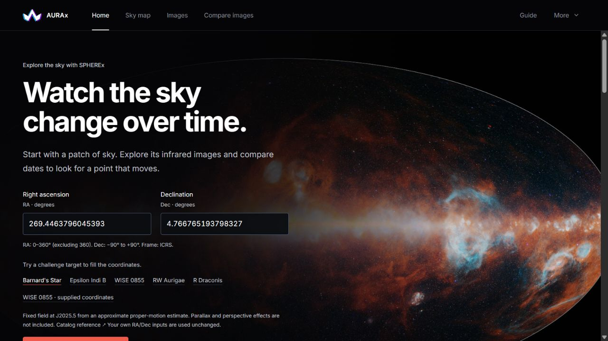
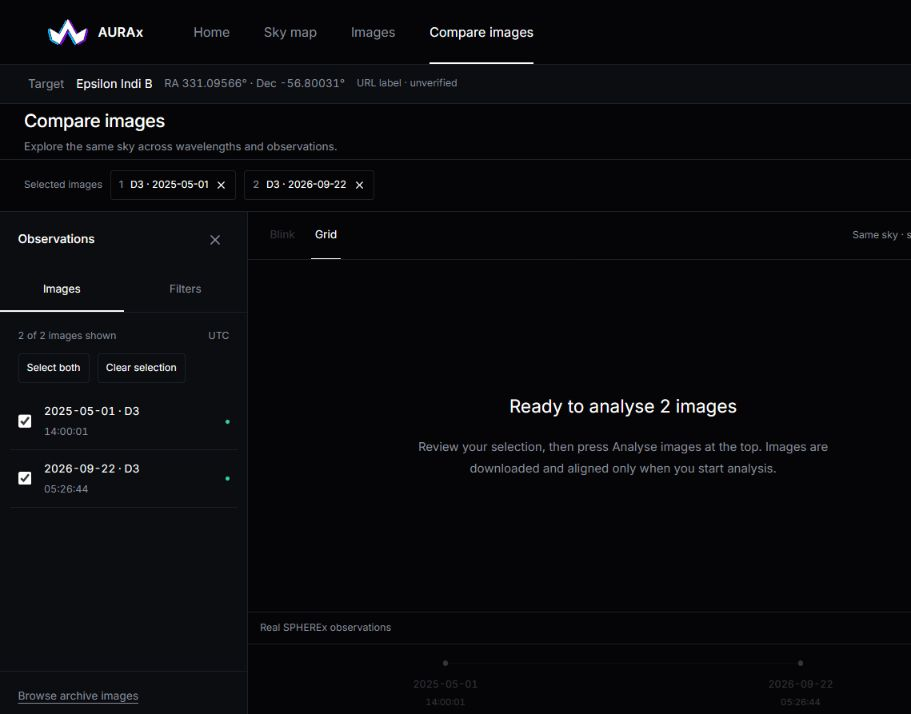
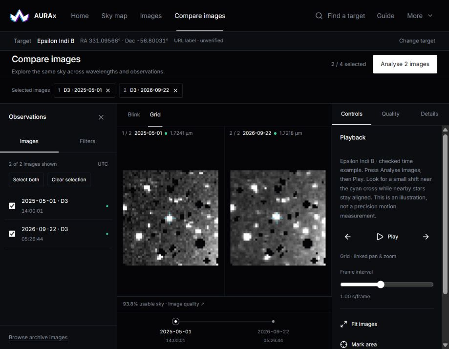
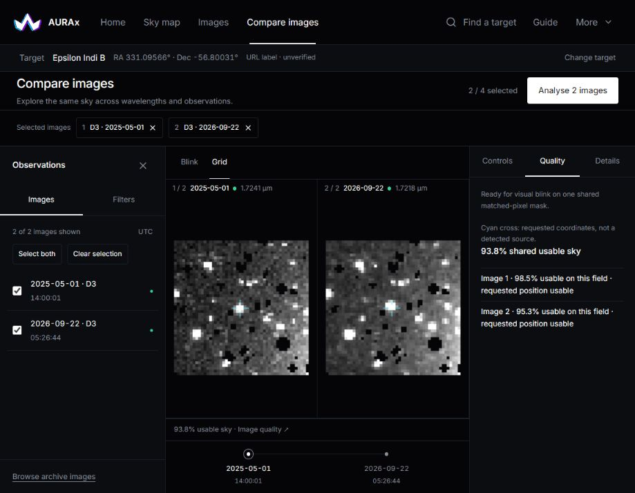
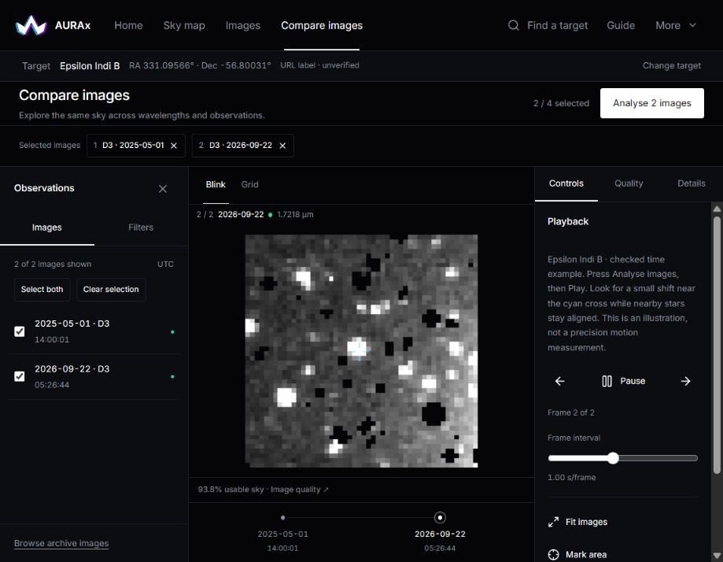
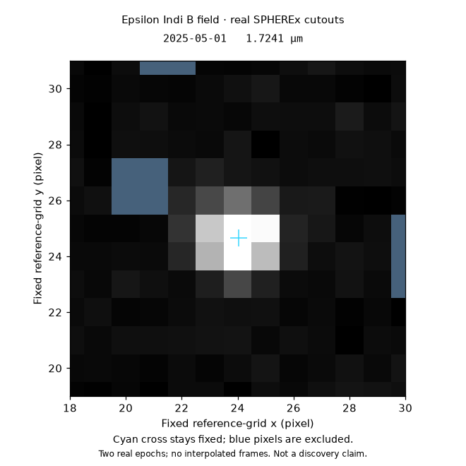
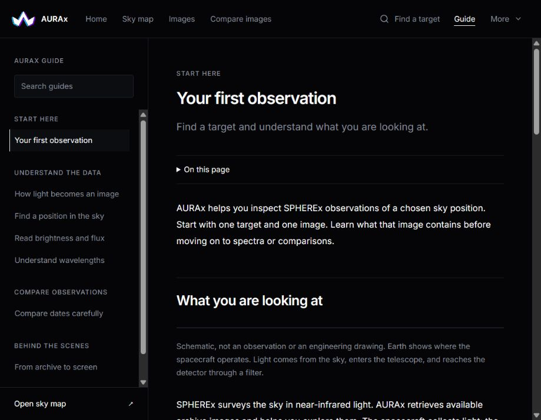

# Use AURAx: a screenshot walkthrough

[Documentation](README.md) · [Live app](https://aurax.thawshi.com) · [Scientific limits](scientific-limits.md)

These screenshots were captured from the public application on **15 November 2026**. They show real UI states, including a successfully prepared two-observation comparison. Current archive availability, coverage, and browser layout can differ. [Capture manifest](images/README.md).

## 1. Choose a sky position

Open [Home](https://aurax.thawshi.com). Enter right ascension in degrees from 0 inclusive to 360 exclusive, and declination from −90 to +90. Choose a challenge target to open its Images workspace immediately. For manual coordinates, select **Open images** beside the inputs (directly beneath them on phones). Object-name lookup fills coordinates for review before opening images.

*Home provides coordinate entry and target shortcuts. Its large NASA/JPL-Caltech cover is a published infrared mosaic, not a queried observation frame.*

The challenge shortcuts use a fixed approximate J2025.5 field centre. Your own coordinate inputs are used unchanged. Read the position and epoch explanation before treating a crosshair as a source.

## 2. Start with a checked example

For a focused first run, select **Try a checked Epsilon Indi B time comparison** on Home. The example selects two real D3 products: 1 May 2025 and 22 September 2026. Selection alone does not download the observation pixels.

Click **Analyse 2 images**. The app retrieves small target cutouts sequentially, then applies calibration, quality, wavelength, and registration checks. Keep the current frame visible while preparation runs. If it fails, read the error and retry later; no replacement observation is generated.

## 3. Inspect the aligned grid

Once preparation succeeds, both dates appear on one sky grid with a shared contrast scale. The target wavelengths are approximately 1.7241 and 1.7218 micrometres.

*Live capture after successful preparation. The cyan cross indicates the requested coordinates, not an independently identified detection.*

Use linked pan/zoom to inspect the same sky region in both frames. Read the actual dates and wavelengths above each image. A difference may arise from noise, flags, wavelength response, or background, not only astronomical change.

## 4. Read Quality before interpreting change

Open the right-hand **Quality** tab.

In this capture, **93.8% shared usable sky** passed the common matched-pixel screen, and the requested position was usable in both images. That percentage describes the field's retained pixels. It is not a detection confidence, source-identification probability, or motion significance.

For another sequence, coverage can be lower or preparation can be blocked. Check individual image warnings. Use replacement selection when a poor frame makes the comparison unhelpful; replacing a frame does not relax masks.

## 5. Blink, pause, and step

Return to **Controls**, choose **Blink**, then **Play**. Adjust **Frame interval** to control the time per frame. Pause and use previous/next to compare a specific feature.

*The capture shows playback enabled after successful preparation. A still screenshot cannot itself demonstrate motion.*

The previously recorded animation below uses the same two identified observations. It is a separate validation artifact, not a recording of this browser session.

A possible shift near the marker is consistent with known catalog motion in the [documented exploratory check](epsilon-indi-example-validation-2026-11-15.md). Do not call this precision astrometry, a resolved-binary measurement, or a new discovery.

## 6. Browse your own observations

For a new field, use Home's **Open images** action or **Images**. Filter the retrieved observations by date, detector subset, release, or search text where offered. Begin with the default small field and enlarge it only when more context is needed.

In **Compare images**, select two to four distinct observations and press **Analyse images**. General comparison can mix wavelengths and is useful for exploring spectral appearance. For stricter time comparison, use matching-wavelength mode and inspect its checks. Four general-comparison frames do not automatically form a verified time sequence.

Click an image region in Images to inspect local values and quality. Catalog names are possible reference associations, not confirmed detections. Save a target through the navigation tools to return later; the saved Spectrum panel loads bounded nearest-pixel samples explicitly.

## 7. Use the conceptual guide

Select **Guide** in the top navigation or open [the documentation](https://aurax.thawshi.com/docs). Search or choose a chapter.

The chapters explain first observations, optics, coordinates, brightness, wavelengths, careful comparison, and archive access. Their conceptual schematics are distinct from measured observation frames.

## Common problems

| What you see | What to do |
| --- | --- |
| No matching observations | Check coordinates, dates, and detectors; a bounded result is not a complete archive history. |
| Archive busy or request timeout | Retry later. Service failure does not establish no coverage. |
| Checkered or excluded areas | Read the native flags and masks; missing pixels are not filled. |
| Play disabled | Check selection count, completion of analysis, and quality/wavelength eligibility. |
| Different brightness across dates | Check passbands, background, masks, and display scaling before inferring variability. |
| Old Home content after deployment | Verify the running frontend tag and cache; see [deployment troubleshooting](deployment.md#update-an-existing-deployment). |

Next: [scientific limits](scientific-limits.md), [full example evidence](epsilon-indi-example-validation-2026-11-15.md), or [developer setup](development.md).
